


 

 

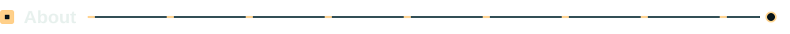

I'm an Electronics & Computer Science Engineering student at Shah & Anchor Kutchhi Engineering College. I like building practical software, exploring applied AI, and getting better by shipping real projects.

- **Building:** NeuroSaathi, cognitive games and memory support for older adults
- **Learning:** Python and Data Structures & Algorithms
- **Interested in:** software development, applied AI, and solving real problems with code


  

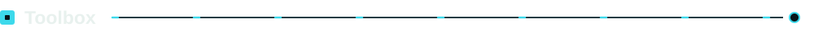


Python and DSA are what I'm learning right now. These are the tools I work with or am exploring, not a claim of mastery.

  

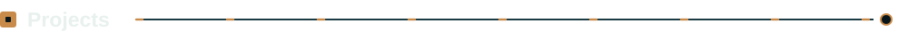

<a href="https://github.com/Blankk18/neurosaathi">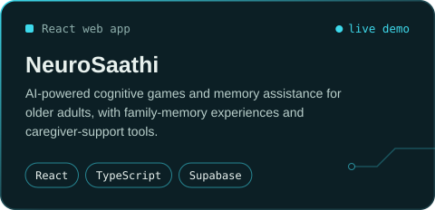</a>
<a href="https://github.com/Blankk18/JavaMicroProject">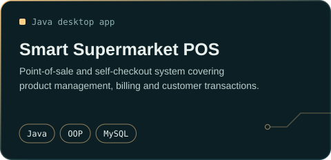</a>

<a href="https://github.com/Blankk18?tab=repositories">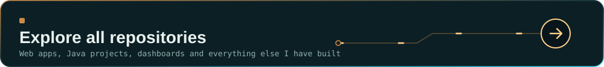</a>

 

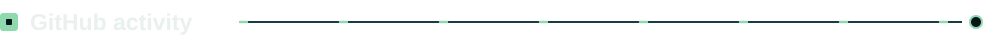


  

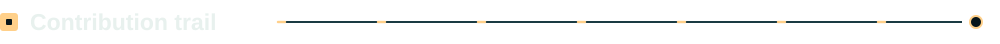

<picture>
  <source media="(prefers-color-scheme: dark)" srcset="https://raw.githubusercontent.com/Blankk18/Blankk18/output/github-contribution-grid-snake-dark.svg"/>
  <source media="(prefers-color-scheme: light)" srcset="https://raw.githubusercontent.com/Blankk18/Blankk18/output/github-contribution-grid-snake.svg"/>
  
</picture>

  

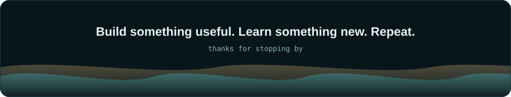
